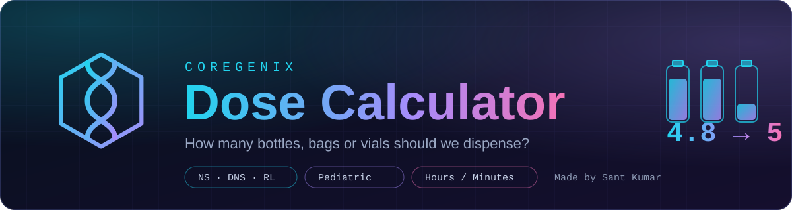

<div align="center">



<br>

[](https://coregenix.github.io/coregenix-dose-calculator/)
[](https://github.com/coregenix/coregenix-dose-calculator/actions)
[](LICENSE)


**A fast, offline-capable dose calculator that answers one question:**
### *"How many bottles, bags or vials should we dispense?"*

[**Open the calculator**](https://coregenix.github.io/coregenix-dose-calculator/) · [Report a bug](https://github.com/coregenix/coregenix-dose-calculator/issues) · [Suggest a feature](https://github.com/coregenix/coregenix-dose-calculator/issues)

</div>

---

## Why this exists

Pharmacy and ward staff calculate dispensing quantities many times a day:

> *Dose is 100 mL/hr. The bottle is 500 mL. How many do we send for 24 hours?*

By hand that is `100 × 24 = 2,400 mL`, `2,400 ÷ 500 = 4.8`, **round up → 5 bottles** — easy once, error-prone fifty times in a shift, and worse with mL/min rates, 2 mL ampoules or a child's weight. **COREGENIX Dose Calculator** does it instantly, shows the working, and tells you exactly what is left over.

## Features

| | |
|---|---|
| ⚡ **Infusion / Injection calculator** | Enter container size and prescribed rate → units to dispense, exact fraction, wastage, how long each container lasts and the container-change schedule |
| 🕒 **Hours *or* Minutes** | Dispense for any duration, and enter the rate as **mL/hr** or **mL/min** |
| 💧 **Every container size** | 500 mL NS / DNS / RL / D5W bags **and** 1, 2, 3, 5, 10, 20, 50, 100, 250, 1000 mL — or type any custom size |
| 📋 **All injections at once** | Build the whole patient chart (fluids + vials) and get one dispensing list with totals — saved in your browser |
| 🧒 **Pediatric mode** | Holliday–Segar maintenance fluid (4-2-1 rule), mL/kg/hr infusions, and mg/kg injection dosing with single-dose vs multi-dose vial counts |
| 📊 **Size comparison table** | See the same volume against every container size side by side |
| 💧 **Drip rate** | gtt/min for 10, 15, 20 and 60 gtt/mL giving sets |
| 🧾 **Shows the working** | Step-by-step calculation like a hand worksheet, with Copy and Print buttons |
| 🔒 **Private by design** | 100 % client-side. No server, no tracking, no patient data ever leaves the page |
| ✅ **Tested** | Core maths is unit-tested (`npm test`) and shared between the site and the tests |

## Worked example

| Input | Value |
|---|---|
| Prescribed rate | 100 mL/hr |
| Container | 500 mL DNS bottle |
| Duration | 24 hours |

```
Total volume = 100 mL/hr × 24 hr = 2,400 mL
Containers   = 2,400 ÷ 500       = 4.8
Round up     → dispense 5 × 500 mL   (4 full + 1 used to 400 mL, 100 mL left over)
```

More examples (all verified in the test-suite):

| Rate | Duration | Container | Total | Dispense |
|---|---|---|---|---|
| 125 mL/hr | 24 h | 500 mL | 3,000 mL | **6** (exact fit) |
| 100 mL/hr | 90 min | 500 mL | 150 mL | **1** |
| 3 mL/hr | 24 h | 10 mL vial | 72 mL | **8** |
| 0.5 mL/hr | 24 h | 2 mL ampoule | 12 mL | **6** |
| 2 mL/min | 1 h | 100 mL | 120 mL | **2** |

## Pediatric calculations

**Maintenance fluid (Holliday–Segar)**

| Body weight | Daily | Hourly (4-2-1) |
|---|---|---|
| First 10 kg | 100 mL/kg | 4 mL/kg/hr |
| Next 10 kg | 50 mL/kg | 2 mL/kg/hr |
| Each kg above 20 | 20 mL/kg | 1 mL/kg/hr |

e.g. a **15 kg** child → 1,000 + 250 = **1,250 mL/day** → 40 + 10 = **50 mL/hr** → with 100 mL bags for 24 h: 1,200 mL ÷ 100 = **12 bags**.
Rates are capped at the adult maximum (100 mL/hr, 2,400 mL/day); neonates under 3 kg show a warning because they follow separate protocols.

**mg/kg injections** — `dose = weight × mg/kg`, `volume = dose ÷ (vial mg ÷ vial mL)`, `doses = per-day × hours ÷ 24`, with an optional maximum single dose. You get both the **single-dose vial** count (fresh vial each dose) and the **multi-dose vial** count.

## Run it

No build step, no installs.

```bash
git clone https://github.com/coregenix/coregenix-dose-calculator.git
cd coregenix-dose-calculator
# just double-click index.html — or serve it:
npx serve .
```

### Run the tests

```bash
npm test          # or: node tests/calc.test.js
```

### Publish on GitHub Pages

**Option A — GitHub Actions (recommended, included):**
`Settings → Pages → Build and deployment → Source: GitHub Actions`. Every push to `main` runs the tests and deploys the site.

**Option B — straight from the branch:**
`Settings → Pages → Source: Deploy from a branch → main / (root)`.

Your site will be live at `https://<your-username>.github.io/coregenix-dose-calculator/`.

## Project structure

```
coregenix-dose-calculator/
├── index.html            # the app
├── css/style.css         # dark, responsive, print-friendly theme
├── js/
│   ├── calc.js           # pure calculation logic (browser + Node)
│   └── app.js            # UI wiring
├── tests/calc.test.js    # unit tests (node:assert, zero deps)
├── assets/               # logo + banner
├── .github/workflows/    # test + GitHub Pages deploy
├── package.json
└── LICENSE
```

## Roadmap

- [ ] Drug-specific dilution library (concentration, stability, compatible fluids)
- [ ] Infusion pump programming sheet (VTBI / rate)
- [ ] Hindi and other language UIs
- [ ] Installable PWA with full offline cache
- [ ] Export dispensing list to PDF

Contributions are welcome — open an issue or a pull request.

## ⚠️ Disclaimer

This software is provided for **calculation support and education only**. It is not a medical device and does not replace professional judgement. Always verify every result against the original prescription, your institution's protocols and a qualified pharmacist or physician **before dispensing or administering**.

## Author

<table>
<tr>
<td width="96"></td>
<td>

**Made by Sant Kumar** — Founder of **COREGENIX**
M.Pharm (Pharmacology) · building innovative healthcare, biotech and AI-driven research solutions.

[GitHub · @coregenix](https://github.com/coregenix)

</td>
</tr>
</table>

## License

Released under the [MIT License](LICENSE) © 2026 COREGENIX — Sant Kumar.

<div align="center">

**⭐ If this saved you time, please star the repo!**

<sub>COREGENIX · Science meets code</sub>

</div>
